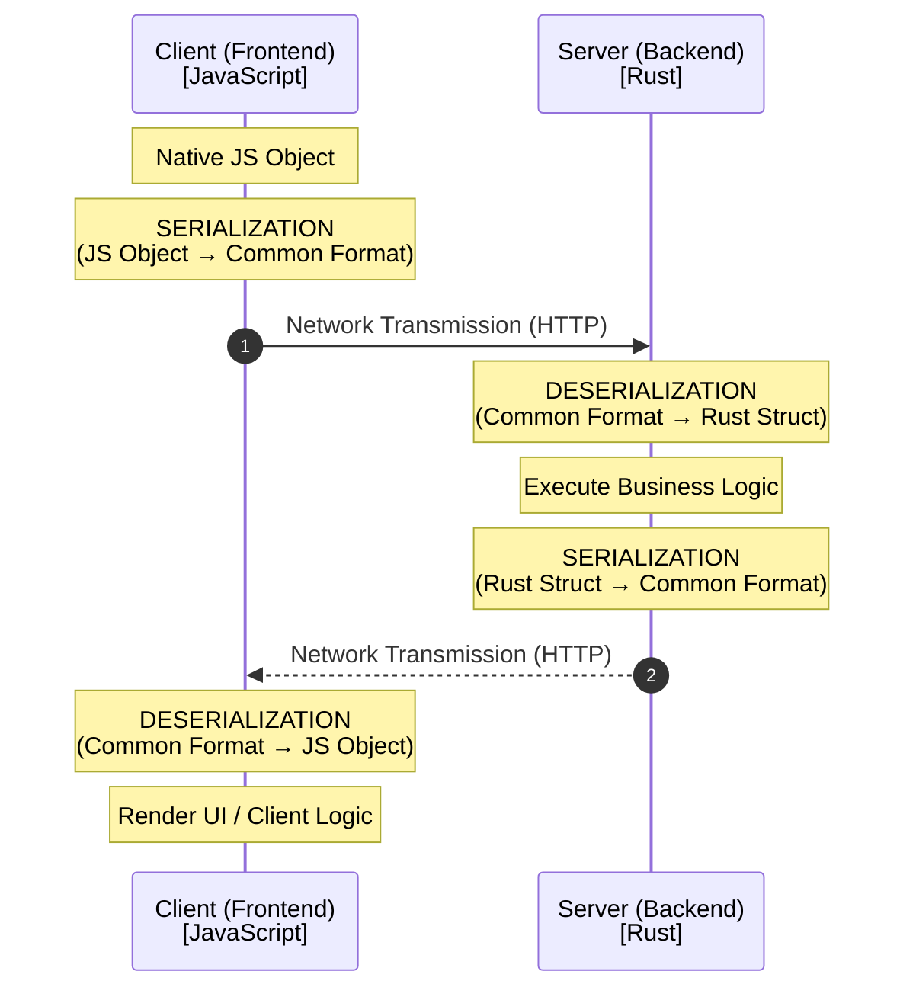
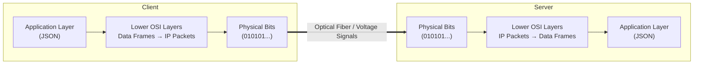

# Serialization and Deserialization for Backend Engineers

> **Topic:** Cross-language client-server communication, type system mismatches, the Application Layer mental model, text-based vs. binary serialization standards, deep dive into JSON syntax rules, and end-to-end request/response payload lifecycle.

## Table of Contents

1. [The Core Problem: Cross-Language Client-Server Communication](#1-the-core-problem-cross-language-client-server-communication)

2. [The OSI Model & The "Common Standard" Solution](#2-the-osi-model--the-common-standard-solution)

3. [Industry Technology Choices & Categories of Serialization Standards](#3-industry-technology-choices--categories-of-serialization-standards)

4. [Deep Dive into JSON (JavaScript Object Notation)](#4-deep-dive-into-json-javascript-object-notation)

5. [End-to-End Request & Response Payload Inspection](#5-end-to-end-request--response-payload-inspection)

## 1. The Core Problem: Cross-Language Client-Server Communication

### The Typical System Architecture

* **The Client (Frontend):** Typically a web browser (such as Chrome) running a highly interactive JavaScript application built with a framework or library like React, Angular, or Vue.

* **The Server (Backend):** Running either locally (`localhost`) or remotely on cloud infrastructure (AWS, GCP, Azure, etc.).

* **Communication Channels:** Clients and servers communicate over the network using protocols such as **HTTP** (traditional REST API endpoints), **gRPC**, or **WebSockets**. For traditional REST API architectures, HTTP is the primary transport medium.

### How HTTP Requests Carry Data

* The client initiates an HTTP request (`GET` or `POST` with a target URL like `domain.com/path`, headers, and—for `POST` requests—a **Request Body** containing the data payload to be sent to the server).

* The server processes the incoming request and returns a response payload that the client must parse and make sense of.

### The Fundamental Data-Type Mismatch Problem (JavaScript vs. Rust Example)

Suppose the frontend is a **JavaScript** application sending a native object (`{ name: "some string" }`) inside the request body, and the backend web server is written in **Rust**:

* **Why this creates a fundamental challenge:** JavaScript and Rust have completely incompatible type systems and runtime architectures:

  * **JavaScript:** A completely dynamic, interpreted (non-compiled) language.

  * **Rust:** A strictly typed, compiled language with completely different native memory representations and data types (such as structs).

* **The Central Engineering Question:** How does a data structure created in one programming language (JavaScript), transmitted across a network to another machine running a completely different programming language (Rust), get parsed into the server's native data types to execute business logic, and then get transmitted back so the client can understand it to render UI or execute client-side logic?

## 2. The OSI Model & The "Common Standard" Solution

### High-Level OSI Model Context

* When data travels over hardware across the internet, it traverses the **OSI Model** stack.

* On both the client machine and the server machine, the OSI stack has the **Application Layer** at the top and the **Physical Layer** at the bottom, with transport and network layers in between.

* While lower layers handle frames, IP packets, and physical signals, backend engineers operate at the Application Layer.

### Designing a Language-Agnostic Solution from First Principles

To enable two separate machines running different languages in different environments to exchange, parse, and understand data in a **language-agnostic** way, both sides must agree on a **Common Standard**—a shared set of formatting rules that both the client and server adhere to when sending requests and responses.

### The End-to-End Conversion Lifecycle



1. **Client $\rightarrow$ Network (Serialization):** During user session execution, the client takes its native language data (e.g., a JavaScript object), transforms/converts it into the agreed **common standard format**, and transmits it over the network.

2. **Network $\rightarrow$ Server (Deserialization):** The server receives the data in that common standard and converts it into its own native language construct (e.g., converting it into a **Rust `struct`**) so it can understand the data format and execute business logic.

3. **Server $\rightarrow$ Network (Serialization):** When preparing the response, the server converts its native data structure (e.g., the **Rust `struct`**) back into the **common standard format** and transmits it over the internet.

4. **Network $\rightarrow$ Client (Deserialization):** The client reads the common format, parses it back into native **JavaScript**, and executes its UI rendering or application logic.

### Core Definition

> **Serialization and Deserialization** is the process of converting data **to and from a common standard format** during **transmission or storage** so that the data is **domain-agnostic and language-agnostic**—allowing machines, servers, and clients across different languages and environments to parse, understand, and respond to the data seamlessly.

## 3. Industry Technology Choices & Categories of Serialization Standards

### The "Most Used in Industry" Engineering Approach

Backend engineering encompasses hundreds of tools and protocols. Mastering the dominant industry standard in each foundational category provides a rock-solid baseline:

* **Data Transmission Protocols:** HTTP (REST APIs), WebSockets, gRPC $\rightarrow$ **HTTP** (REST APIs remain the most common communication standard).

* **Databases:**

  * *Relational:* **PostgreSQL**, MySQL, SQLite $\rightarrow$ **PostgreSQL** is the dominant choice for modern startups and enterprise backends.

  * *Non-Relational (NoSQL):* MongoDB, AWS DynamoDB.

* **Serialization Standards:** $\rightarrow$ **JSON** is used roughly **80% of the time** for client-server HTTP communication.

### The Two Main Categories of Serialization Standards

| Category | Formats | Primary Characteristics & Use Cases | 
| ----- | ----- | ----- | 
| **1. Text-Based Serialization** | • **JSON** *(Primary standard for HTTP)*<br>• **YAML**<br>• **XML** | Encodes data into human-readable text formats. **JSON** is the universal standard for HTTP client-server communication, while **YAML** and **XML** are widely used for configuration files, document structures, and specialized serialization tasks. | 
| **2. Binary Format Serialization** | • **Protobuf** (Protocol Buffers)<br>• **Avro** | Encodes data into compact, non-human-readable binary byte streams for maximum throughput and minimal payload size. **Protobuf** is the most popular binary serialization format (commonly paired with gRPC). | 

## 4. Deep Dive into JSON (JavaScript Object Notation)

### What is JSON?

* **JSON** stands for **JavaScript Object Notation** because its syntax and structure were inspired by native JavaScript object literals.

* **Completely Language-Independent:** Despite having "JavaScript" in its name, JSON is **not** tied to JavaScript—it is a universal data-interchange standard supported across every modern programming language (Go, Rust, Python, Java, PHP, C#, Ruby, etc.).

### Common Real-World Use Cases of JSON

1. **HTTP REST API Transmission:** Sending request payloads and returning response payloads between clients and servers.

2. **Configuration Files:** Storing structured application settings, package manifests, and environment configurations.

3. **Application & Server Logging:** Generating structured runtime log files that can be easily indexed and queried by log management systems.

### Strict Syntax & Structural Rules of JSON

JSON was specifically designed to be **human-readable** while mapping cleanly to fundamental programming data types:

1. **Rule 1 – Curly Braces (`{ }`):** Every JSON object must begin with an opening curly brace `{` and end with a closing curly brace `}`.

2. **Rule 2 – Keys MUST be Double-Quoted Strings:** Every key inside a JSON object **must** be a string enclosed in double quotes (`"key"`). Single quotes, unquoted identifiers, or other data types cannot be used as keys.

3. **Rule 3 – Allowed Value Data Types:** A value mapped to a key (separated by a colon `:`) must be one of the following core types:

   * **String:** Text enclosed in double quotes (e.g., `"India"`).

   * **Number:** Integer or floating-point numeric values (e.g., `3456`).

   * **Boolean:** `true` or `false`.

   * **Array:** An ordered list enclosed in square brackets `[ ... ]`.

   * **Nested JSON Object:** Another object enclosed in `{ ... }` that recursively obeys the exact same rules (double-quoted string keys and valid JSON value types).

#### Example of a Valid Nested JSON Object

```json
{
  "address": {
    "country": "India",
    "phoneNumber": 3456
  }
}
```

## 5. End-to-End Request & Response Payload Inspection

### 1. Request Payload Analysis (`POST /api/books`)

When a frontend client submits a `POST` request to `/api/books` to create a new record, the client serializes its native object into a JSON string in the HTTP request body:

```json
{
  "id": 1,
  "title": "Backend Engineering Fundamentals",
  "author": "Alice"
}
```

* Enclosed in opening and closing curly braces `{ }`.

* All keys (`"id"`, `"title"`, `"author"`) are double-quoted strings.

* Values adhere to standard JSON primitives (a number for `id`, strings for `title` and `author`).

### 2. The Backend Engineer's Mental Model of the OSI Stack



* **What Happens Under the Hood (Lower OSI Layers):** After the client's Application Layer serializes data into JSON, lower network, transport, and physical layers encapsulate that JSON into **Data Frames**, **IP Packets**, and finally raw **Physical Bits (`0101...`)** transmitted as electrical voltage signals or optical fiber light pulses across the internet. When those bits arrive at the server's Physical Layer, the server's network stack reassembles the packets and frames and passes the data up to the server's Application Layer as **JSON** again.

* **What You Need to Focus On as a Backend Engineer:** You do not need to manage the intermediate conversions (frames, IP packets, bits) below the Application Layer. Your mental model at the **Application Layer** is straightforward:
  

  $$
  \text{Client serializes to JSON} \longrightarrow \text{Transmitted over HTTP} \longrightarrow \text{Server deserializes JSON} \longrightarrow \text{Server serializes response to JSON} \longrightarrow \text{Client deserializes JSON}
  $$

### 3. Response Payload & Client Rendering

1. The server receives the `POST /api/books` JSON body, deserializes it into its native language format, appends the new book entry to its data store, and serializes the updated collection into a JSON response object:

```json
{
  "books": [
    {
      "id": 1,
      "title": "Backend Engineering Fundamentals",
      "author": "Alice"
    }
  ]
}
```

2. The client (whether built in JavaScript, PHP, or any other frontend technology) receives the JSON response, deserializes it back into native objects, and renders the updated list in the user interface.

### Summary

Serialization and deserialization are not complex theoretical constructs—they are the practical mechanism of converting application data into and out of a **common, standardized format (such as JSON)** so that clients and servers written in completely different programming languages and running in separate environments can exchange data, parse it accurately, execute business logic, and communicate seamlessly.