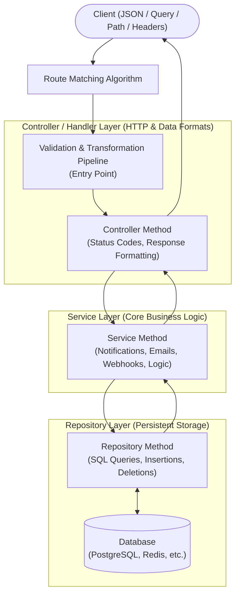
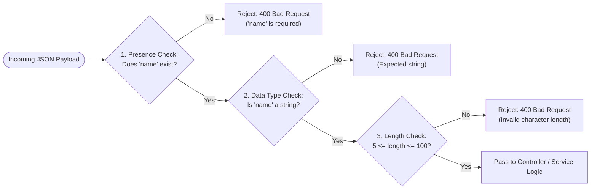
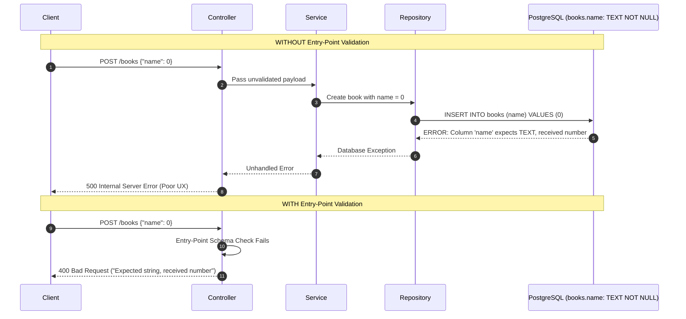
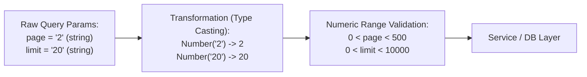
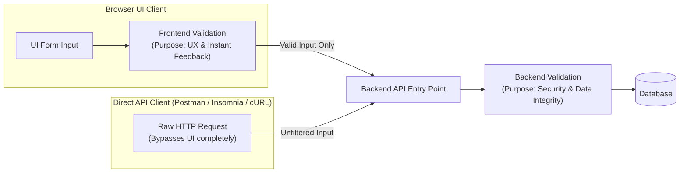

# Validations and Transformations for Backend Engineers

> **Topic:** Three-tier backend architecture placement, entry-point validation schemas, database constraint failure scenarios, Syntactic, Semantic, Type, and Complex validations, data casting/transformations, and Frontend vs. Backend validation responsibilities.

## Table of Contents

1. [Backend Architecture Layers & Where Validation Fits](#1-backend-architecture-layers--where-validation-fits)
2. [Why Entry-Point Validation Matters & What Happens Without It](#2-why-entry-point-validation-matters--what-happens-without-it)
3. [The 3 Core Categories of Validation](#3-the-3-core-categories-of-validation)
4. [Understanding Data Transformations & Type Casting](#4-understanding-data-transformations--type-casting)
5. [Practical API Validation & Transformation Scenarios](#5-practical-api-validation--transformation-scenarios)
6. [Frontend Validation vs. Backend Validation](#6-frontend-validation-vs-backend-validation)

---

## 1. Backend Architecture Layers & Where Validation Fits

### Core Purpose of Validations & Transformations
Validations and transformations are a set of rules and guidelines kept in mind while designing APIs, primarily focused on **data integrity** and **security**.

### The Three Layers of Execution in a Typical Backend Architecture

1. **Repository Layer (Bottom Layer):**
   * Deals directly with database connections, query executions, insertions, deletions, and all persistent storage operations (whether a traditional relational database like PostgreSQL, or an in-memory store like Redis).
2. **Service Layer (Middle Layer):**
   * Deals with executing core **business logic** and defines all the functionality an API call performs.
   * A single service method may call one or more repository methods to interact with databases, send notifications to multiple devices, send emails to users, store data, make webhook calls, and return the expected data.
3. **Controller Layer (Top Layer):**
   * Receives incoming requests from the client, calls the associated method in the service layer, and returns the resulting data to the user over the HTTP connection.
   * **Why Separate the Controller Layer from the Service Layer?** To isolate **HTTP-related logic and data handling** into its own boundary—such as deciding which HTTP status code (error or success code) to return, formatting the outgoing API response, and handling input validations. The controller layer manages everything coming in from and going out to the client, while delegating business logic to the service layer (which may or may not call the repository layer depending on requirements).

### Exact Placement of Validations & Transformations
1. When a client sends data (typically a JSON payload), it first hits the server's **route-matching algorithm**.
2. Once the route pattern is matched, the router invokes the assigned **Controller method**.
3. **The Exact Entry Point:** Validations and transformations execute **right after the route is matched and at the very beginning of the controller layer**—*before* any significant controller logic runs, *before* calling any service layer methods, and *before* touching the database.

---

## 2. Why Entry-Point Validation Matters & What Happens Without It

### Validating All Incoming Data Channels
Clients all over the world make HTTP API calls carrying data across multiple channels:
* **JSON payloads** (request body)
* **Query parameters**
* **Path parameters**
* **Headers**

At the first entry point, the server must verify that 100% of this incoming data matches the exact structure and constraints expected by the API.

### How the Validation Schema/Middleware Pipeline Works (The `name` Field Example)
Suppose an API expects a JSON request body containing a `name` field that must be a `string` with a length between **5 and 100 characters**. At the entry point, a reusable middleware or utility function validates the incoming JSON against a defined **schema** step by step:

1. **Presence Check:** Checks if the `name` key exists in the JSON payload. If missing, it immediately returns an error stating `name` is required.
2. **Data Type Check:** Checks if the value of `name` is a `string` (not an array, boolean, or number). If not a string, it immediately returns a type mismatch error.
3. **Length Constraint Check:** Checks if the string length is between 5 and 100 characters. If the user sends a massive paragraph ($> 100$ chars) or a 2-character string ($< 5$ chars), it immediately rejects the request with a customized length error.

### Failure Scenario: What Happens If You Skip Entry-Point Validation?

* **The Setup:** Suppose you are creating a new book row in a **PostgreSQL** database table (`books`) where the `name` column is defined with constraints `TEXT NOT NULL` (expecting a string).
* **The Bad Input:** A client sends `{"name": 0}` (passing the number `0` instead of a string), and there is **no validation pipeline** at the entry point.
* **The Chain Reaction Without Validation:**
  1. The unvalidated JSON `{"name": 0}` enters the **Controller Layer**.
  2. The controller calls the **Service Layer**, which executes business logic.
  3. The service layer calls the **Repository Layer**, which executes an `INSERT` SQL query into PostgreSQL with `0` for a `TEXT` column.
  4. **Database Crash & `500 Internal Server Error`:** PostgreSQL enforces its column data-type constraints and fails the query. Depending on server error handling, the server returns HTTP **500 Internal Server Error** to the client—indicating something unexpected broke on the server, which is a poor user experience for a simple form submission.
* **The Proper Outcome With Entry-Point Validation:** By validating at the entry point before running business or database logic, the server catches the invalid format immediately and returns HTTP **400 Bad Request**, instructing the client to fix their request format and retry.

---

## 3. The 3 Core Categories of Validation

While validation rules can be tailored to any domain requirement, you will primarily encounter three overarching categories when designing APIs:

| Validation Type | Core Definition | Specific Examples & Rules |
| :--- | :--- | :--- |
| **1. Syntactic Validation** | Validates whether a provided value adheres to a specific **structural syntax or pattern**. | • **Emails:** Must have an initial local part (`first`), an `@` symbol, a domain name, and a top-level domain (`.com`, `.co`, `.in`, etc.). • **Phone Numbers:** Must follow a structural pattern such as a valid country code (from a global list) followed by the exact number of digits required for that country (e.g., 10 digits). • **Dates:** Must follow a specific date format expected by the API, such as `YYYY-MM-DD` (Year-Month-Day). |
| **2. Semantic Validation** | Validates whether the provided data **makes logical sense** in the real-world domain context. | • **Date of Birth (DOB):** Even if syntactically valid (`YYYY-MM-DD`), a DOB cannot be in the future (e.g., if today is `2025-01-11`, a DOB of `2025-01-13` is rejected). • **User Age:** Even if a valid number, an age of `365` or `430` does not make sense for a human and must be rejected. |
| **3. Type Validation** | Validates whether fields match the expected **primitive or composite data types**. | • Checking whether a field is a `string`, `number`, `boolean`, `array`, or a nested custom JSON object containing its own typed fields (including element-level validation inside arrays). |

---

## 4. Understanding Data Transformations & Type Casting

### What is Transformation?
Transformation is the process of executing operations on incoming user data to convert, normalize, or cast it into the exact format and data type required by the server—either **before** running validation rules or **after** validation succeeds.

### Why Transformation is Necessary: The Query Parameter Problem
Consider a paginated endpoint: `GET /bookmarks?page=2&limit=20`

1. **The Validation Rules:** Suppose your paginated `/bookmarks` endpoint enforces:
   * `page`: must be a **number**, $> 0$ and $< 500$.
   * `limit`: must be a **number**, $> 0$ and $< 10,000$ (maximum rows returned at once).
2. **The HTTP Reality:** Because `page` and `limit` are passed in the URL query string (`?page=2&limit=20`), **all query parameter values arrive at the server as strings by default** (`page: "2"`, `limit: "20"`).
3. **What Happens Without Transformation:** If you run type validation directly on the raw query parameters, validation immediately **fails** on the very first check (`Expected number, received string`)—even though the client did nothing wrong.
4. **The Solution (Type Casting / Transformation):** It is the **server's responsibility** to **cast** (force conversion of one data type into another) the incoming strings `"2"` and `"20"` into numbers `2` and `20` *before* checking the $> 0$ and $< 500$ numeric range constraints.

### Why Pair Validation & Transformation in a Single Pipeline?
Grouping both into a unified **Validation and Transformation Pipeline** keeps all input data-layer requirements and pre-processing logic in one centralized location rather than scattered across controllers and services.

---

## 5. Practical API Validation & Transformation Scenarios

> **Self-Documenting API Bonus:** When API documentation is missing, sending an empty payload `{}` to an endpoint with strict entry-point validation immediately informs the consumer of every expected field and constraint via the returned validation error array.

### Scenario A: Syntactic Validation (`POST /api/valid/syntactic`)
1. **Empty JSON `{}`:** Immediately returns an array of validation errors stating three required fields are missing: `email`, `phone`, and `date`.
2. **Invalid Values (`email`: random string, `phone`: number, `date`: `"2025-01-11"`):** The `date` passes, while the server returns two errors: `"Invalid email format"` for `email`, and `"Expected string, received number"` for `phone`.
3. **Valid Values (`email`: `"test@test.com"`, `phone`: string, `date`: `"2025-01-11"`):** All structural constraints are satisfied and the server returns **200 OK**.

### Scenario B: Semantic Validation
* **Target Requirements:** Expects `dob` (Date of Birth) and `age` (number).
* **Valid Input:** Sending `dob: "1995-06-12"` and `age: 43` returns **200 OK**.
* **Future Date of Birth:** Changing the year to `2026` (`"2026-06-12"`) triggers a semantic error: `"Date of birth cannot be in the future"`.
* **Illogical Age:** Reverting `dob` to `1995` and setting `age: 430` triggers a semantic range error: `"Number must be less than or equal to 120"` (enforcing a logical human age range of `1` to `120`).

### Scenario C: Complex / Cross-Field & Conditional Validation
* **Target Requirements:** Expects `password`, `passwordConfirmation`, and `married` (boolean).
* **Rule 1 – Password Length & Cross-Field Equality:**
  * Sending a short password (`"random"`, 6 chars) and a non-matching confirmation string triggers two errors: `"String must contain at least 8 characters"` for `password`, and `"Passwords don't match"` for `passwordConfirmation`.
  * Extending `password` to $\ge 8$ characters and matching `passwordConfirmation` (with `married: false`) succeeds with **200 OK**.
* **Rule 2 – Conditional Field Requirement (`married` $\rightarrow$ `partner`):**
  * Changing `married` from `false` to `true` causes the request to fail with a dynamic conditional error: `"Partner name is required when married is true"`.
  * `partner` is completely optional when `married: false`, but dynamically becomes mandatory when `married: true`. Adding `"partner": "some name"` returns **200 OK**.

### Scenario D: Data Transformation Pipeline
* **Input Sent by Client:**
  * `email`: Mixed uppercase and lowercase characters (e.g., `"TeSt@Example.COM"`).
  * `phone`: A numeric string *without* a leading `+` symbol (e.g., `"1234567890"`).
  * `date`: A standard date string.
* **Transformations Applied Automatically by the Server Pipeline Before Service Execution:**
  1. **`email` Normalized:** Converted entirely to **all lowercase** characters (`"test@example.com"`).
  2. **`phone` Formatted:** Prepended the **`+` character** to the front of the phone number string (`"+1234567890"`).
  3. **`date` Converted:** Calculated and formatted into the target date representation required by the service layer.

### Scenario E: Strict Type & Nested Array Element Validation
* **Target Requirements:** Expects `stringField`, `numberField`, `arrayField`, and `booleanField`.
* **Step 1 (All Strings Sent):** Passing strings for all four fields passes `stringField`, but fails the other three with `"Expected number/array/boolean, received string"`.
* **Step 2 (Element-Level Array Validation):** Fixing `numberField: 10`, `booleanField: false`, and passing `arrayField: [1, 2]` (an array of numbers) triggers a deeper element-level type error inside `arrayField` at indices `0` and `1`: `"Expected string, received number"`.
* **Step 3 (All Types Satisfied):** Changing `arrayField` to an array of strings `["string", "string"]` satisfies every top-level and element-level constraint and returns **200 OK**.

---

## 6. Frontend Validation vs. Backend Validation

### The Common Architectural Mistake
Developers sometimes rely on frontend form validation and skip or relax backend validation. **You ALWAYS need both layers**, because they serve fundamentally different purposes.

| Validation Layer | Primary Purpose | Why It Cannot Replace the Other |
| :--- | :--- | :--- |
| **Frontend (Client-Side) Validation** | **User Experience (UX) & Immediate Feedback** | Gives instant visual feedback in the UI form before firing a network call (saving bandwidth and round-trip latency). However, it provides **zero security** because any user or attacker can bypass the browser UI entirely. |
| **Backend (Server-Side) Validation** | **Security & Data Integrity (Mandatory)** | A backend API can be called by web apps, mobile apps, or directly via API clients like **Postman**, **Insomnia**, or `cURL` where no frontend UI validation exists. If the server relies on frontend validation, anyone calling the API directly can break the server or corrupt the database. |

### How Both Layers Work Together in Production
1. **Invalid Input in Browser UI:** When a user enters an invalid email in a form and clicks **Submit**, **client-side validation** catches it immediately—blocking submission and making **zero network API calls**.
2. **Valid Input in Browser UI:** Once the user fixes the email format and clicks **Submit**, client-side validation passes, the network request is dispatched to the backend, the **server-side validation and transformation pipeline** verifies and normalizes the payload, and the server returns **200 OK**.