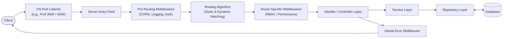
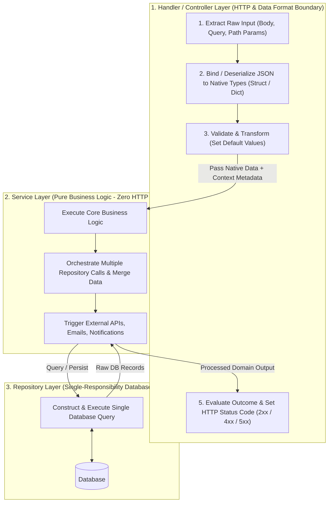
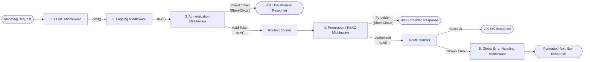
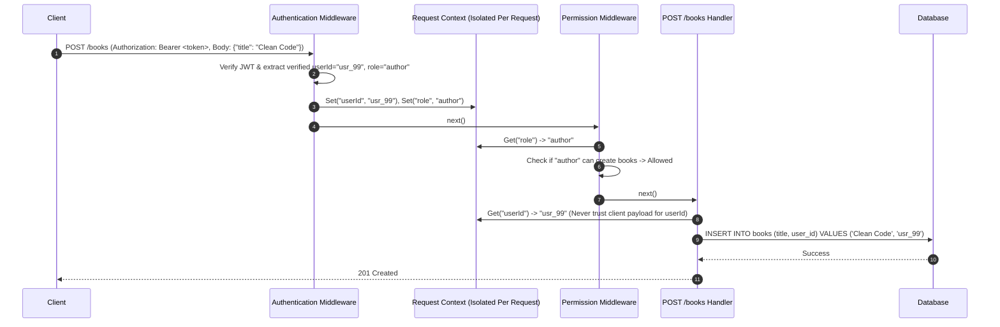

# Controllers, Services, Repositories, Middlewares & Request Context

> **Topic:** The internal server request lifecycle, the three-tier architectural pattern (Handlers/Controllers, Services, Repositories), strict layer isolation rules, Middleware execution pipelines and ordering, and Request Context scoping and security.

## Table of Contents

1. [Introduction & The Internal Server Request Lifecycle](#1-introduction--the-internal-server-request-lifecycle)
2. [Deep Dive: Handlers / Controllers, Services, and Repositories](#2-deep-dive-handlers--controllers-services-and-repositories)
   - [Layer 1: The Handler / Controller Layer](#a-layer-1-the-handler--controller-layer)
   - [Layer 2: The Service Layer](#b-layer-2-the-service-layer)
   - [Layer 3: The Repository (Database) Layer](#c-layer-3-the-repository-database-layer)
   - [Returning Up the Stack & Layer Comparison](#d-returning-up-the-stack--summary-of-the-3-layers)
3. [Deep Dive: Middlewares](#3-deep-dive-middlewares)
   - [What is a Middleware & Where Does It Sit?](#a-what-is-a-middleware--where-does-it-sit)
   - [Why Use Middlewares & The Crucial Ordering Rule](#b-why-use-middlewares--the-crucial-ordering-rule)
4. [Deep Dive: Request Context](#4-deep-dive-request-context)
   - [What is Request Context & Strict Request Scoping](#a-what-is-request-context--strict-request-scoping)
   - [Production Use Cases & Security Against ID Spoofing](#b-production-use-cases--security-against-id-spoofing)

---

## 1. Introduction & The Internal Server Request Lifecycle

### Why Study These Three Concepts Together?
* **Handlers (Controllers), Services, and Repositories**, **Middlewares**, and **Request Context** are tightly interconnected components inside a backend server's execution pipeline. Studying them in a single shared execution context shows how data, control flow, and state move across boundaries from the moment a request arrives until a response is dispatched.

### External vs. Internal Request Lifecycle
* **External Request Lifecycle:** How a client communicates with a server over HTTP (establishing connections, sending requests, and receiving responses).
* **Internal Request Lifecycle:** Everything that happens **inside the server** from the exact millisecond an incoming request reaches the server process until the final HTTP response is sent back to the client.

### Step-by-Step Internal Entry Flow
1. **Server Entry Point & OS Port Forwarding:**
   * A backend server binds to and listens on a specific network port (e.g., port `3000`, `4000`, or any configured port).
   * The moment the Operating System forwards an incoming HTTP request to that port, the request hits the **Entry Point** of the server application.
2. **Routing to a Handler:**
   * After passing any global pre-routing middlewares, the request enters the server's **routing mechanism / routing algorithm** (matching static routes like `/users` or dynamic routes like `/users/123`).
   * Based on the HTTP method and matched route pattern, the router maps the request to a specific **Handler** (also called a **Controller**)—a predefined function responsible for handling requests for that specific API endpoint.
3. **Why Separate Into 3 Components (Handler/Controller, Service, Repository)?**
   * **No Hard Technical Requirement:** Technically, you *can* write all database queries, business logic, and HTTP formatting inside a single Handler function.
   * **Software Design Pattern Benefits:** Separating responsibilities into three distinct layers makes the codebase **scalable**, **maintainable**, **easier to extend with new features**, and **significantly easier to debug**.

---

## 2. Deep Dive: Handlers / Controllers, Services, and Repositories

### A. Layer 1: The Handler / Controller Layer

#### Default Runtime Parameters (`Request` and `Response` Objects)
Across virtually all backend languages and frameworks (such as **Golang**, **Node.js / Express**, or **Python**), every Handler automatically receives at least **two objects/variables** injected by the language runtime or web framework:
1. **`Request` Object:** Used by the Handler to extract headers, parameters, and payloads from the incoming HTTP request.
2. **`Response` Object:** Used by the Handler to configure response headers, set the HTTP status code, and transmit the serialized HTTP response back to the client.

Because the request was already matched by the routing algorithm to reach this specific Handler, the server already knows *which* API endpoint the client invoked. The Handler executes a strict sequence of responsibilities:

#### Responsibility 1: Extracting & Binding (Deserializing) Request Data
1. **Extracting Raw Data Based on HTTP Method:**
   * **`GET` Request:** Extract **query parameters** and **path parameters**.
   * **`POST` Request:** Extract the **request body** (and any path/query parameters).
   * **`DELETE`, `PUT`, or `PATCH` Requests:** Extract the **request body**, **path parameters**, and **query parameters** depending on the endpoint specification.
2. **Deserialization / Data Binding into Native Language Types:**
   * Data travels over the network in a serialized format—most commonly **JSON**—which strongly typed or non-JS languages cannot manipulate directly as native structures.
   * **Language-Specific Behavior:**
     * **Node.js (JavaScript):** Because JSON syntax is derived from JavaScript objects, JS has first-class support for it. An upstream middleware (such as `express.json()` / `bodyParser`) typically deserializes JSON into JS objects automatically before routing even occurs.
     * **Golang, Python, Rust:** You must explicitly deserialize the incoming JSON bytes into the language's **native data construct** inside the Handler—such as a native `struct` in **Go** or **Rust**, or a `dict` (dictionary) or class/Pydantic model in **Python**.
   * **Terminology ("Binding"):** Backend frameworks commonly refer to this step as **Binding**—binding the incoming request payload into a native language data structure.
   * **Immediate Failure Handling (`400 Bad Request`):** If deserialization/binding fails (e.g., malformed JSON syntax or incompatible types), the Handler immediately terminates execution and returns HTTP status **`400 Bad Request`** without calling downstream layers.

#### Responsibility 2: Validation & Transformation Pipeline
1. **Validation:**
   * Once bound into a native format (e.g., a Go `struct` or Python `dict`), the Handler **validates everything** arriving from the external client—including **path parameters**, **request body**, and **query parameters**—enforcing strict type, syntactic, and semantic rules.
2. **Transformation (Setting Defaults for Downstream Convenience):**
   * After validation succeeds, the Handler runs **Transformations**—normalizing and enriching the validated client data so downstream layers have clean, predictable inputs.
   * **API Design Best Practice Rule:** Always design **all query parameters to be optional** in REST APIs.
   * **Concrete Transformation Example (`GET /books` with `sort` Query Parameter):**
     * *Requirement:* A `GET /books` endpoint accepts an optional query parameter `sort` whose allowed values are `"name"` (sort alphabetically by book title) or `"date"` (sort chronologically by creation date).
     * *Client Request:* The client calls `GET /books` **without passing any query parameters**.
     * *Validation Step:* Because query parameters are optional, validation passes without raising a `400 Bad Request` error.
     * *Transformation Step:* Instead of forcing the Service or Repository layers to write messy `if/else` conditional branches checking whether `sort` is `null`/`undefined`, the Transformation step checks if `sort` is missing and **assigns a default value** (e.g., `sort = "date"`).
     * *Result:* Downstream code receives a guaranteed, non-null value and follows a single clean execution path.
3. **Delegating to the Service Layer:**
   * Once extracted, bound, validated, and transformed into a reliable native data structure, the Controller invokes the **Service Layer**, passing both the processed payload data and required request metadata (such as authenticated `userId` and `permissions`).

---

### B. Layer 2: The Service Layer

#### Strict Isolation Rule (Zero HTTP Awareness)
* The Service Layer must **never** import, reference, or depend on any HTTP-related concepts (`Request` objects, `Response` objects, HTTP headers, or HTTP status codes).
* **The "One-Look" Litmus Test:** If you inspect a Service function in isolation, you should **not** be able to tell that it is being invoked by an HTTP web server. It could just as easily be called by a CLI tool, a gRPC server, or a background worker queue.
* A Service method is a pure domain function that accepts native language inputs, executes core business logic, and returns native domain outputs.

#### Core Responsibilities of the Service Layer
1. **Executing Core Business Logic:** Implements all domain rules, calculations, and workflows required by the operation.
2. **External Side Effects (Even Without a Database):** A Service method does not always need to interact with a database. For example, an email-dispatch service takes a recipient address and template parameters, calls an external email provider, and returns `{ success: true }` directly to the Handler without ever calling a Repository. It also handles webhooks, push notifications, and third-party API integrations.
3. **Orchestrating Multiple Repository Calls:** Unlike a Repository method (which executes a single database query), a single Service method can call **multiple different Repository methods**, combine/filter/transform their separate results, and return the aggregated domain object to the Handler.

---

### C. Layer 3: The Repository (Database) Layer

#### Sole Responsibility
* Whenever the Service Layer needs to persist, query, update, or delete data in persistent storage, it calls the **Repository Layer** (also referred to as the **Database Layer**).
* The Repository accepts clean, pre-validated parameters from the Service Layer (e.g., insertion payloads, filter criteria, or `sort = "date"`), **constructs and executes the database query**, and returns the raw database result back to the Service Layer.

#### Strict Single-Responsibility Rule for Repository Methods
* **One Repository Method = One Database Operation / One Kind of Data:** Each repository method must perform a single, unambiguous database operation.
* **Anti-Pattern to Avoid:** Suppose an application needs to fetch *all books* in one endpoint and fetch *a single book by ID* in another endpoint. Never write a single repository method that accepts an optional `id` parameter and conditionally returns either a single book object or an array of books.
* **Correct Pattern:** Define two separate, explicit repository methods—e.g., `findAllBooks(sort)` and `findBookById(id)`.

---

### D. Returning Up the Stack & Summary of the 3 Layers

#### Completing the Request Lifecycle
1. The **Repository Layer** finishes executing the query and returns the database records to the **Service Layer**.
2. The **Service Layer** completes any post-processing or data aggregation and returns the domain result to the **Controller / Handler Layer**.
3. Back in the **Controller / Handler Layer** (which governs the HTTP boundary), the Controller evaluates whether the Service execution succeeded or failed and **selects the appropriate HTTP Response Status Code**:
   * **Success:** Returns a `2xx` status code (`200 OK`, `201 Created`, or `204 No Content`) along with the serialized response body.
   * **Failure:** Returns a `4xx` status code (client/domain error) or `5xx` status code (unexpected server error) with a structured error payload.

| Architectural Layer | Core Focus & Boundary | Exact Responsibilities |
| :--- | :--- | :--- |
| **1. Handler / Controller** | **HTTP & Data Formats** *(Input/Output Boundary)* | 1. Extract data from `Request` object (query params, path params, body). 2. Bind/deserialize JSON into native language types (`struct`/`dict`), or return `400` on failure. 3. Run Validation & Transformation pipeline (e.g., applying defaults to optional query params). 4. Call Service Layer with native data and context metadata. 5. Select HTTP status code (`2xx`/`4xx`/`5xx`) and serialize response via `Response` object. |
| **2. Service Layer** | **Business Logic & Orchestration** *(100% HTTP-Agnostic)* | 1. Execute core domain business logic. 2. Orchestrate calls across one or more Repository methods and merge/process their results. 3. Trigger external side effects (third-party APIs, emails, push notifications). |
| **3. Repository Layer** | **Database Operations** *(Single-Responsibility Queries)* | 1. Accept clean parameters/filters from the Service Layer. 2. Construct and execute a single, specific database query and return the result. |

---

## 3. Deep Dive: Middlewares

### A. What is a Middleware & Where Does It Sit?

#### Placement in the Request Lifecycle
From the moment the OS forwards an incoming request to the server's entry point until the final response leaves the server, **Middleware functions** can be mounted at any execution boundary:
* **Before Routing:** Between the server entry point and the routing algorithm (global middlewares applied to all incoming traffic).
* **After Routing / Before Handler:** Between the routing algorithm and the Handler/Service/Repository stack (route-specific or group-specific middlewares).
* **After Handler / Before Response:** After Handler execution completes or throws an exception, right before the HTTP response is transmitted to the client.

They are called **Middlewares** because they execute *in the middle* of distinct processing boundaries. All middlewares are optional—if none are registered, requests flow directly from routing to the Handler.

#### The 3 Default Runtime Parameters (`req`, `res`, `next`)
A Middleware is a specialized handler injected with **three parameters** by the server runtime:
1. **`request` Object (`req`):** Allows the middleware to inspect or attach metadata to the incoming request.
2. **`response` Object (`res`):** Allows the middleware to modify response headers or **immediately short-circuit and send a response back to the client** (terminating the request early before it ever reaches routing or downstream handlers).
3. **`next` Function (`next()`):** A callback provided by the runtime that passes control across the boundary to the **next processing step** in the pipeline (the next middleware, the routing engine, or the target Handler).

---

### B. Why Use Middlewares & The Crucial Ordering Rule

#### 1. Eliminating Cross-Cutting Duplication Across Endpoints
A production backend may serve millions of requests across hundreds or thousands of API endpoints, each with its own Handler. Nearly every endpoint requires shared cross-cutting concerns: **security/CORS checks**, **request logging**, **authentication**, **body parsing**, and **compression**. Even if extracted into helper functions, manually invoking those helpers inside 1,000 different Handlers creates massive boilerplate and risk of human omission. Middlewares apply these behaviors automatically across routes.

#### 2. Saving Server Resources via Early Termination
Because middlewares sit upstream of Handlers and possess access to `res`, they can reject invalid, unauthenticated, or rate-limited requests immediately—saving CPU cycles, memory allocation, and database connections that would otherwise be wasted downstream.

#### 3. Crucial Rule: Middleware Execution Order Matters
Because requests flow strictly **sequentially** from one middleware to the next via `next()`, the registration order directly determines correctness:
1. **CORS Middleware (First):** Evaluates cross-origin headers and handles `OPTIONS` preflight requests immediately.
2. **Logging Middleware:** Records incoming request metadata (method, path, timestamp, request ID) for observability.
3. **Authentication Middleware:** Verifies session cookies or JWTs before protected routes execute.
4. *(Routing $\rightarrow$ Route-Specific Permission/RBAC Middlewares $\rightarrow$ Handler)*
5. **Global Error Handling Middleware (Last):** Mounted at the very end of the pipeline so any uncaught exception thrown by upstream middlewares, handlers, or services is caught, logged, and formatted into a clean, safe HTTP error response without leaking internal stack traces.

---

## 4. Deep Dive: Request Context

### A. What is Request Context & Strict Request Scoping

* **Core Definition:** **Request Context** (also referred to as **Request State**) is an isolated, per-request key-value storage container attached to a single HTTP request that exists strictly for the duration of that specific request's lifecycle.
* **Built-In Runtime Support:** Provided natively across backend ecosystems (e.g., `context.Context` in Golang, `req` / `AsyncLocalStorage` in Node.js, `request.state` in FastAPI/Starlette).
* **Strict Request Isolation:** If 100,000 clients send 100,000 concurrent requests to your server simultaneously, the server instantiates **100,000 completely isolated Request Context objects**—one per request. Once a request finishes sending its response, its Request Context is garbage-collected.
* **Decoupled State Sharing Across Execution Boundaries:** As a single request traverses multiple layers (`CORS` $\rightarrow$ `Logging` $\rightarrow$ `Auth` $\rightarrow$ `RBAC` $\rightarrow$ `Handler`), upstream middlewares can write key-value pairs into the Request Context that downstream middlewares and Handlers can read without altering function signatures or tightly coupling components together.

---

### B. Production Use Cases & Security Against ID Spoofing

#### Use Case 1: Passing Verified Identity Metadata & Preventing ID Spoofing (`POST /books`)
1. **Upstream Extraction:** In the **Authentication Middleware**, the server validates the caller's cryptographic token or session and extracts their verified **`userId`**, **`role`** (e.g., `user`, `admin`, `sales` per RBAC), and **`permissions`** (`read`, `write`).
2. **Storing in Context:** The Authentication Middleware stores these values as key-value pairs inside the **Request Context**.
3. **Downstream Consumption:** When execution reaches the `POST /books` **Handler** (which inserts a new book row requiring a `user_id` foreign key), the Handler reads `userId` and `role` **directly from the Request Context**.
4. **Why You Must NEVER Trust `userId` from the Client Request Body:**
   * If an API reads `userId` from the client's JSON payload (`{"title": "Book", "userId": "usr_42"}`), a **malicious user** can trivially intercept and modify the JSON payload to send another user's `userId`—creating, modifying, or deleting records under someone else's account (**ID Spoofing / Broken Object Level Authorization**).
   * Reading `userId` and `role` exclusively from the **Request Context** guarantees that authorization checks and database writes always operate on the cryptographically verified identity of the authenticated caller.

#### Use Case 2: Request-Scoped Observability & Distributed Tracing (`requestId`)
* An early logging middleware can generate a unique `requestId` (e.g., a UUID) and store it in the Request Context so every log entry emitted across handlers, services, repositories, and the final error middleware is tagged with the exact same `requestId` for end-to-end debugging.

#### Use Case 3: Cancellation & Timeouts
* In runtimes like Golang (`context.Context`), Request Context also propagates cancellation signals and deadlines down to database queries and external HTTP calls—immediately aborting expensive downstream work if the client disconnects or a timeout expires.