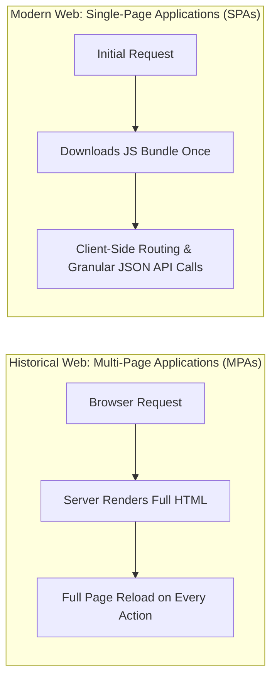
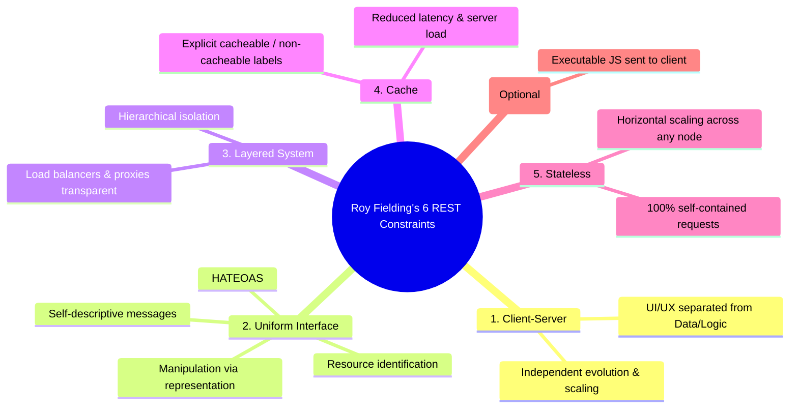
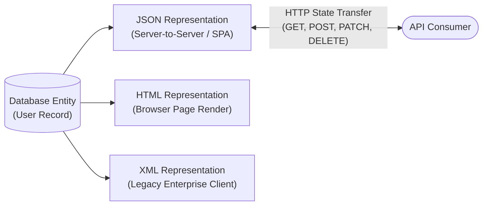
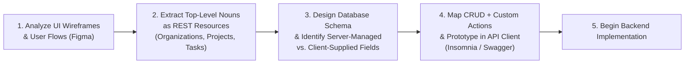
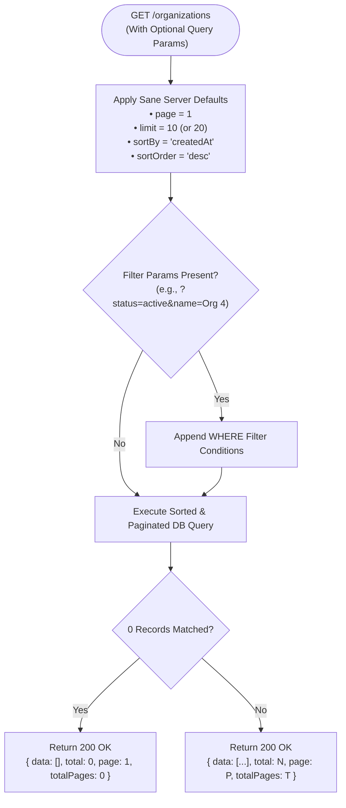

# Complete REST API Design for Backend Engineers

> **Topic:** Historical origins of the Web & REST, Roy Fielding's 6 architectural constraints, deconstructing Representational State Transfer, URL anatomy & slug rules, HTTP methods & idempotency, custom actions, pre-coding API design workflow, pagination/sorting/filtering, cross-resource consistency, and production best practices.

## Table of Contents

1. [Introduction: Why Standardize REST API Design?](#1-introduction-why-standardize-rest-api-design)
2. [Historical Context: The World Wide Web & Birth of REST](#2-historical-context-the-world-wide-web--birth-of-rest)
   - [The Invention of the World Wide Web (1990)](#a-the-invention-of-the-world-wide-web-1990)
   - [Roy Fielding's 6 Architectural Constraints (1993–2000)](#b-roy-fieldings-6-architectural-constraints-19932000)
3. [Deconstructing "Representational State Transfer" (REST)](#3-deconstructing-representational-state-transfer-rest)
4. [URL Anatomy & Strict REST API Route Naming Rules](#4-url-anatomy--strict-rest-api-route-naming-rules)
5. [HTTP Methods, Idempotency & Custom Actions](#5-http-methods-idempotency--custom-actions)
6. [Step-by-Step End-to-End API Design Workflow (Before Coding)](#6-step-by-step-end-to-end-api-design-workflow-before-coding)
7. [Deep Dive: Designing Resource Endpoints (`organizations` & `projects`)](#7-deep-dive-designing-resource-endpoints-organizations--projects)
   - [Complete CRUD + Custom Action Endpoint Matrix](#a-complete-crud--custom-action-endpoint-matrix)
   - [List API Features: Pagination, Sorting, Filtering & Sane Defaults](#b-list-api-features-pagination-sorting-filtering--sane-defaults)
8. [Four Core Best Practices for Production REST APIs](#8-four-core-best-practices-for-production-rest-apis)

---

## 1. Introduction: Why Standardize REST API Design?

### Scope & Focus
* While multiple API paradigms exist—including **RPC calls** and **GraphQL**—**REST APIs** remain the dominant, industry-standard interface for modern web services.
* Even experienced developers frequently face recurring ambiguities during day-to-day backend engineering:
  1. **URI Path Segments:** Should resource names in URI paths be **plural** or **singular**?
  2. **Update HTTP Methods:** When updating a resource, should you use `PATCH` or `PUT`?
  3. **Non-CRUD / Custom Action Operations:** When executing a custom server action (an operation that is not a standard fetch, create, update, or delete), which HTTP method applies (`PATCH`, `PUT`, or `POST`)?
  4. **HTTP Status Codes:** Which exact HTTP status code corresponds to different success, empty-result, creation, and error scenarios?

### Why This Confusion Exists: MPAs vs. SPAs



* **Historical Context (MPAs):** When early HTTP API conventions formed, applications were primarily **Multi-Page Applications (MPAs)** where servers rendered full HTML views and full-entity replacements were common.
* **Modern Context (SPAs):** Modern frontend ecosystems rely heavily on **Single-Page Applications (SPAs)** where the browser downloads a JavaScript bundle once, handles client-side routing, and communicates with backends via granular **JSON** payloads.
* **Objective:** Rather than inventing new conventions, extracting clear, consistent guidelines from established REST standards eliminates guesswork across routes, payloads, status codes, and documentation—freeing engineers to focus purely on business logic.

---

## 2. Historical Context: The World Wide Web & Birth of REST

### A. The Invention of the World Wide Web (1990)
* **Initial Motivation:** In **1990**, **Tim Berners-Lee** initiated the **World Wide Web** project to facilitate global sharing of knowledge and information.
* **Six Foundational Inventions Created Within ~1 Year:**
  1. **URI (Uniform Resource Identifier)**
  2. **HTTP (Hypertext Transfer Protocol):** The underlying communication protocol between clients and servers (evolving from HTTP/1.1 to HTTP/2 and HTTP/3).
  3. **HTML (HyperText Markup Language):** The markup language used to construct the skeleton of web pages.
  4. **The First Web Server**
  5. **The First Web Browser**
  6. **The First WYSIWYG ("What You See Is What You Get") HTML Editor:** Built directly into the browser.
* **The Web Scalability Crisis:** Exponential global adoption rapidly pushed early web architecture toward breakdown, requiring formal architectural constraints and protocol standardization to scale.

### B. Roy Fielding's 6 Architectural Constraints (1993–2000)



Around **1993**, **Roy Fielding** (co-founder of the Apache HTTP Server project) defined **six architectural constraints** to solve the web's scalability crisis:

| # | REST Architectural Constraint | Core Principle & Scalability Benefit |
| :--- | :--- | :--- |
| **1** | **Client-Server** | Enforces strict separation of concerns: the **client (frontend)** manages UI and user experience, while the **server (backend)** handles data storage and business logic. Enables independent evolution and scaling of both tiers. |
| **2** | **Uniform Interface** | Establishes a standardized contract across all services, governed by **4 sub-constraints**:<br>1. *Resource identification* (via URIs)<br>2. *Resource manipulation through representation*<br>3. *Self-descriptive messages*<br>4. *Hypermedia as the engine of application state (HATEOAS)* |
| **3** | **Layered System** | Organizes architecture into hierarchical layers where each component only interacts with its immediate neighbor. Allows transparent insertion of **load balancers**, **reverse proxies**, and **CDNs** for scalability and security. |
| **4** | **Cache** | Server responses must explicitly declare whether they are **cacheable** or **non-cacheable**. Caching eliminates redundant network roundtrips, lowers latency, and reduces server compute load. |
| **5** | **Stateless** | Every request must contain **100% of the information** required to process it; the server retains **zero client session context** between requests. Any server instance behind a round-robin load balancer can serve any incoming request. |
| **6** | **Code-on-Demand** *(Optional)* | Servers can temporarily extend client functionality by transferring executable code (e.g., **JavaScript**) to the client. This is the sole optional constraint in REST. |

* **Standardization of HTTP/1.1 & PhD Dissertation (2000):** Fielding collaborated with Tim Berners-Lee to co-author the **HTTP/1.1** specification and formally defined this architectural style as **REST (Representational State Transfer)** in his **2000 PhD dissertation**.

---

## 3. Deconstructing "Representational State Transfer" (REST)



1. **Representational (Format of the Resource):**
   * Server resources (data/entities) are serialized into a specific representation format tailored to the consumer—most commonly **JSON**, **HTML**, or **XML**.
   * The exact same underlying database resource (e.g., a `User` record with `id`, `name`, `createdAt`) can be represented as **JSON** for a mobile/SPA/server client or rendered as **HTML** for a browser view.
2. **State (Current Attributes of the Resource):**
   * Represents the current properties and condition of a resource at a point in time (e.g., in an e-commerce shopping cart, the **state** includes the current array of items, quantities, and total price).
3. **Transfer (Movement Between Client & Server):**
   * The bidirectional exchange of resource representations between client and server over **HTTP** using standard verbs (`GET`, `POST`, `PUT`, `PATCH`, `DELETE`, `OPTIONS`, `HEAD`).

---

## 4. URL Anatomy & Strict REST API Route Naming Rules

### Standard Website URL vs. Industry-Standard REST API URL

```
Standard Website URL:
https://example.com/resources?key=value#section
└─┬─┘   └────┬────┘└───┬────┘└───┬────┘└───┬───┘
Scheme    Domain      Path     Query    Fragment

Industry-Standard REST API URL:
https://api.example.com/v1/books/harry-potter
└─┬─┘   └──────┬──────┘└┬┘└──┬──┘└─────┬──────┘
Scheme   API Subdomain Ver. Collection Resource Slug / ID
```

* **Scheme:** `https://` (encrypted TLS transport).
* **API Subdomain:** `api.example.com` (industry convention isolating API traffic from marketing/frontend domains).
* **Route Versioning:** `/v1` or `/v2` to prevent breaking changes across client releases.
* **Resource Path Segment:** `/books` or `/books/:id`.

### Strict URL Path & Slug Formatting Rules

1. **Rule 1 — Always Use Plural Nouns for Resources:**
   * Whether fetching a collection (`GET /v1/books`) or a **single** record (`GET /v1/books/:id`), the resource path segment must **always be plural** (`/books`, **never** `/book/:id`).
   * *Why?* Forward slashes (`/`) express **hierarchical containment**: `/books` represents the collection of all books in storage (Level 1), and `/:id` selects a single item within that collection (Level 2).
2. **Rule 2 — Lowercase Only & Hyphens Instead of Spaces or Underscores (Slugs):**
   * **Never** use uppercase letters, spaces, or underscores (`_`) in URL path segments, IDs, or slugs. Different operating systems, proxies, and web servers treat URL casing inconsistently, causing subtle case-mismatch bugs.
   * **Slug Conversion Rule:** Convert all characters to lowercase and replace spaces with hyphens (`-`). For example, `"Harry Potter"` becomes `/books/harry-potter`.

---

## 5. HTTP Methods, Idempotency & Custom Actions

### Idempotency in REST APIs
An API operation is **idempotent** if executing the exact same request $N$ times sequentially ($1$ time vs. $1,000$ times) produces the **exact same server-side state change / side effect** as executing it once:

$$
f(f(x)) = f(x)
$$

> *Crucial Clarification:* Idempotency measures **the side effects caused on the server by the client's request**, not whether the returned response data changes because another user inserted new records in between calls.

| HTTP Method | Semantic Operation | Idempotent? | Server Side-Effect Analysis & Usage Rules |
| :--- | :--- | :--- | :--- |
| **`GET`** | Retrieve resource(s) | **Yes** | Strictly read-only. Calling `GET /books` 1,000 times triggers zero state mutations on the server. |
| **`PATCH`** | **Partial** resource update | **Yes** | Sends only the delta of fields to update (e.g., `{"name": "B"}`). Calling it 1,000 times with `{"name": "B"}` leaves the resource's name in state `"B"` every time. Preferred over `PUT` in modern JSON SPAs. |
| **`PUT`** | **Complete** resource replacement | **Yes** | Overwrites the entire existing resource with a complete payload containing every field. Repeated calls with the identical full payload leave the resource in the exact same state. |
| **`DELETE`** | Remove a resource | **Yes** | Calling `DELETE /users/1` once deletes user `1`. Calling it a second or millionth time returns `404 Not Found` because the record is already gone—causing **zero new side effects** after the first call. |
| **`POST`** | 1. Create a new resource<br>2. **Custom Actions** | **No** *(Non-Idempotent)* | **1. Creation:** Calling `POST /books` with identical book attributes 1,000 times inserts **1,000 separate database rows** with distinct server-generated IDs.<br>**2. Custom Actions:** Because non-CRUD operations (e.g., `POST /emails/send`) do not fit fetch, update, or delete semantics, the REST specification designates `POST` as the **open-ended method** for custom actions. |
| **`HEAD` / `OPTIONS`** | Headers & CORS preflight | **Yes** | `HEAD` returns response headers without a body; `OPTIONS` handles CORS preflight capability checks. |

---

## 6. Step-by-Step End-to-End API Design Workflow (Before Coding)

A production REST API must be **designed first, not programmed right away**. Failing to adhere to standard REST conventions forces API consumers to read your backend source code or reverse-engineer endpoints through trial and error.



1. **Start from UI Wireframes & User Journeys:** Trace how end users interact with screens and data (`End User` $\rightarrow$ `Frontend` $\rightarrow$ `Backend API` $\rightarrow$ `Database`).
2. **Extract Top-Level Nouns as REST Resources:** Identify every domain noun from the wireframes (e.g., in a project management platform: `organizations`, `projects`, `tasks`, `users`, `tags`).
3. **Design the Database Schema & Separate Field Ownership:**
   * **Server/Database-Managed Fields (Never accepted from client payloads):** `id`, `createdAt`, `updatedAt`.
   * **Client-Supplied Fields:** Domain attributes such as `name`, `status`, `description`, and foreign keys like `organizationId`.
4. **Map Standard CRUD + Custom Actions & Prototype in an API Client:** Define every endpoint's route, method, request payload, query parameters, and response status codes inside an interactive API client (**Insomnia**, **Postman**, or **Swagger/OpenAPI**) *before* writing server code.

---

## 7. Deep Dive: Designing Resource Endpoints (`organizations` & `projects`)

### A. Complete CRUD + Custom Action Endpoint Matrix

| Operation | HTTP Method & Route | Request Payload / Params | Success Status Code & Response Body |
| :--- | :--- | :--- | :--- |
| **Create Organization** | `POST /organizations` | `{"name": "Org 1", "status": "active", "description": "..."}` | **`201 Created`** — Returns the newly created organization entity (including server-generated `id`, `createdAt`, `updatedAt`). |
| **List Organizations** | `GET /organizations` | Optional query params: `?page=1&limit=10&sortBy=createdAt&sortOrder=desc&status=active` | **`200 OK`** — Returns paginated envelope: `{"data": [...], "total": 5, "page": 1, "totalPages": 1}`. |
| **Get Single Organization** | `GET /organizations/:id` | Dynamic path parameter `:id` | **`200 OK`** with the single entity, or **`404 Not Found`** if `:id` does not exist. |
| **Update Organization** | `PATCH /organizations/:id` | Partial JSON payload (e.g., `{"description": "Updated"}`) | **`200 OK`** — Returns the updated organization entity. |
| **Delete Organization** | `DELETE /organizations/:id` | Dynamic path parameter `:id` | **`204 No Content`** — Empty response body. |
| **Custom Action: Archive** | `POST /organizations/:id/archive` | Dynamic path parameter `:id` (no body required) | **`200 OK`** — Returns the updated archived organization (does *not* return `201` because no new resource was created). |
| **Custom Action: Clone Project** | `POST /projects/:id/clone` | Dynamic path parameter `:id` | **`201 Created`** — Returns the newly cloned project entity (`404 Not Found` if source `:id` does not exist). |

#### Why Custom Actions (`archive`, `clone`) Use `POST` Instead of `PATCH`
* **Archiving an Organization (`POST /organizations/:id/archive`):** In a real system, archiving does more than flip a `status` column—it triggers cascading side effects such as archiving/deleting child projects and tasks and sending notification emails to members.
* **Cloning a Project (`POST /projects/:id/clone`):** Triggers deep server-side duplication of the project and its child tasks, creating a brand-new resource instance (which is why it returns **`201 Created`**, whereas `archive` modifies state without creating a new entity and returns **`200 OK`**).

---

### B. List API Features: Pagination, Sorting, Filtering & Sane Defaults



1. **Pagination (`limit` & `page`):**
   * Returning thousands of rows in one response causes severe JSON serialization overhead and network latency when the UI only displays 10–20 rows at a time.
   * **The 4 Standard Paginated Response Fields:**
     * `data`: Array containing the current slice of records.
     * `total`: Total matching records in the database independent of pagination (allows UIs to render *"Showing 10 of 50"*).
     * `page`: Current page number returned.
     * `totalPages`: Total number of available pages (`ceil(total / limit)`), enabling infinite-scroll clients to stop requesting once `page === totalPages`.
2. **Deterministic Sorting (`sortBy` & `sortOrder`):**
   * Databases do **not** guarantee row ordering unless explicitly sorted. Every list endpoint must apply a default sort (`sortBy=createdAt`, `sortOrder=desc`) so responses remain deterministic and return newest items first.
   * Clients can override sorting dynamically (e.g., `?sortBy=name&sortOrder=asc`).
3. **Field-Based Filtering:**
   * Clients filter collections using resource field names as query parameters (e.g., `GET /organizations?status=archived` or `GET /organizations?status=active&name=Org 4`).
4. **Crucial `200 OK` vs. `404 Not Found` Rule:**
   * **Single-Resource Endpoint (`GET /organizations/:id`):** Return **`404 Not Found`** if the specific record does not exist.
   * **List Endpoint (`GET /organizations?status=nonexistent`):** **Never** return `404` when a list or filter matches zero items. Always return **`200 OK`** with an empty array (`{"data": [], "total": 0, "page": 1, "totalPages": 0}`).

---

## 8. Four Core Best Practices for Production REST APIs

1. **Maintain Interactive OpenAPI / Swagger Documentation:**
   * Integrate **Swagger / OpenAPI** from the initial design phase to provide an interactive playground where consumers can inspect schemas and test endpoints directly.
2. **Enforce 100% Cross-Resource Consistency:**
   * **JSON Casing:** Use **`camelCase`** consistently across every JSON request payload and response field (`organizationId`, `createdAt`).
   * **Identical Field & Route Naming:** If `POST /organizations` names a field `"description"`, `POST /projects` must also use `"description"`—never abbreviate it to `"desc"` on another resource. Similarly, if `/organizations` is plural, `/projects` and `/tasks` must also be plural so integrators never have to guess.
3. **Provide Sane Defaults Everywhere (`GET` and `POST`):**
   * **In `GET` List Endpoints:** Default `page = 1`, `limit = 10` (or `20`), `sortBy = "createdAt"`, and `sortOrder = "desc"` when omitted by the client.
   * **In `POST` Create Endpoints:** Only mark fields as required when strictly necessary to create the entity. Default `status = "active"` and make `description` optional so clients can create an organization with a minimal payload (`{"name": "Org Name"}`).
4. **Never Use Abbreviations in Payload Keys or Query Parameters:**
   * External integrators do not share your internal engineering context. Always use full, self-explanatory field and parameter names (`description` instead of `desc`).